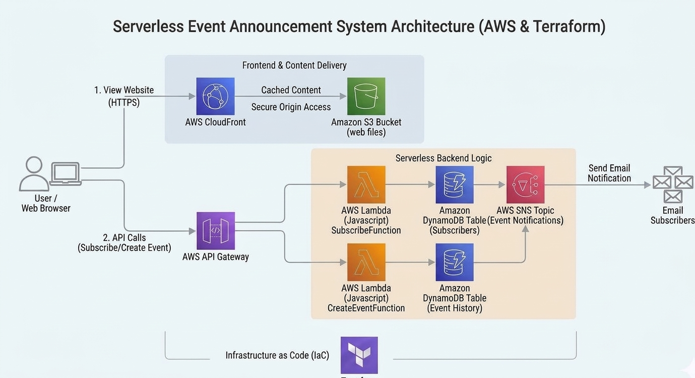

# Serverless Event Announcement & Broadcast System (AWS using Terraform)

A production-grade, fully serverless event announcement and subscription platform built on AWS using **Terraform (Infrastructure as Code)**. This project adheres to modern AWS security standards, featuring zero public S3 exposure via CloudFront Origin Access Control (OAC), least-privilege IAM policies, and on-demand serverless scaling.

---

## 🏗️ Request Flow

The architecture is entirely serverless, ensuring zero idle server management costs and automatic scalability.

```text
[Visitor/Admin] 
       │
       ▼ (HTTPS)
 [Amazon CloudFront CDN] ──(Origin Access Control / SigV4)──► [Private Amazon S3 Bucket]
       │
       ▼ (REST API)
 [Amazon API Gateway HTTP API v2]
       ├──► POST /subscribe ──► [AWS Lambda: subscribe] ──► [DynamoDB: subscribers] & [Amazon SNS]
       └──► POST /events    ──► [AWS Lambda: create_event] ──► [DynamoDB: event-history] & [Amazon SNS Email Broadcast]
```

## 🧭 Architecture Diagram




### Complete Request Flow

1. **Frontend Hosting:** Users access the static frontend (`index.html`, `admin.html`) globally via CloudFront. CloudFront fetches assets securely from a completely private S3 bucket using **Origin Access Control (OAC)**.
2. **Subscription Flow (`POST /subscribe`):**
* A user enters their email on the public page.
* API Gateway triggers the `subscribe` Lambda function.
* Lambda writes a `PENDING` record to the DynamoDB `subscribers` table and triggers Amazon SNS to send a confirmation email.


3. **Event Broadcast Flow (`POST /events`):**
* An administrator creates an announcement in the Admin Portal (`admin.html`).
* API Gateway triggers the `create_event` Lambda function.
* Lambda logs the event to the DynamoDB `event-history` table and fans out an automated email broadcast to all confirmed subscribers via **Amazon SNS**.


---

## 🛡️ Security & Engineering Highlights

* **Zero Public S3 Access:** The S3 bucket blocks all public access (`aws_s3_bucket_public_access_block`), allowing reads exclusively through CloudFront via **Origin Access Control (OAC)** and AWS SigV4 signing.
* **Least-Privilege IAM:** Lambda execution roles are locked down strictly to CloudWatch logging, designated DynamoDB table actions (`PutItem`, `GetItem`, `Scan`), and SNS topic publishing/subscribing.
* **Infrastructure as Code (IaC):** Fully reproducible environment provisioned using Terraform v1.5+.
* **Serverless Scaling:** Utilizes API Gateway HTTP APIs (v2) for low latency/cost and DynamoDB on-demand billing (`PAY_PER_REQUEST`).

---

## 📁 Folder Structure

```text
event-announcement-system/
├── terraform/
│   ├── main.tf
│   ├── variables.tf
│   ├── outputs.tf
│   ├── iam.tf
│   ├── s3.tf
│   ├── cloudfront.tf
│   ├── sns.tf
│   ├── lambda.tf
│   ├── apigw.tf
│   └── dynamodb.tf
├── lambda/
│   ├── subscribe/
│   │   └── index.js
│   └── create_event/
│       └── index.js
├── frontend/
│   ├── index.html
│   ├── admin.html
│   └── app.js
├── deploy.sh
└── README.md

```

---

## 🚀 Tech Stack

* **Cloud Provider:** AWS (Amazon Web Services)
* **Infrastructure as Code:** Terraform (v1.5+)
* **Compute & Routing:** AWS Lambda (Node.js 18.x), Amazon API Gateway (HTTP API v2)
* **Storage & CDN:** Amazon S3, Amazon CloudFront (with OAC)
* **Database:** Amazon DynamoDB (On-Demand billing)
* **Messaging:** Amazon SNS (Simple Notification Service)
* **Frontend:** HTML5, Vanilla JavaScript, CSS3

---

## ⚙️ Prerequisites & Quick Start

### Prerequisites

1. **AWS CLI** installed and configured (`aws configure` with valid credentials).
2. **Terraform** (v1.5 or higher) installed locally.
3. **Node.js** (v18.x+) installed for Lambda runtime dependencies.
4. A Unix-like shell environment (Linux, macOS, or Git Bash on Windows) to run the deployment script.

To clone, set up, and run this project locally, follow these straightforward steps:

### 1. Clone the Repository

Open your terminal and clone your repository to your local machine, then navigate into the project directory:

```bash
git clone https://github.com/shakil-noor/event-announcement-system.git
cd event-announcement-system

```

### 2. Configure AWS Credentials

Ensure your local environment has permissions to deploy resources to your AWS account by configuring your AWS CLI credentials:

```bash
aws configure

```

*(Enter your AWS Access Key ID, Secret Access Key, region—e.g., `us-east-1`—and preferred output format).*

### 3. Deploy the Terraform Infrastructure

If you prefer to provision the infrastructure step-by-step manually:

1. Navigate to the Terraform directory:
```bash
cd terraform

```


2. **Initialize Terraform:**
Initialize the working directory and download the required AWS provider plugins.
```bash
terraform init

```


3. **Preview the Infrastructure:**
Generate and review the execution plan to see what resources will be created.
```bash
terraform plan

```


4. **Apply the Configuration:**
Provision the AWS infrastructure (S3, CloudFront, API Gateway, Lambda, DynamoDB, SNS).
```bash
terraform apply

```


*(Type `yes` when prompted to confirm deployment.)*

---

### 4. Upload the file to S3 and Invalidate CloudFront cache (Recommended)

Make the deployment script executable and run it:
```bash
chmod +x deploy.sh
./deploy.sh

```


*(This script injecting the API Gateway URL into your frontend, syncing static assets to S3, and invalidating the CloudFront cache).*


*(Type `yes` when prompted to confirm).*

### 5. Access the Live System

Once the deployment finishes successfully, copy the **CloudFront Domain Name** outputted by Terraform and open it in your web browser to test your live serverless event announcement platform!
